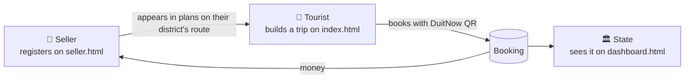
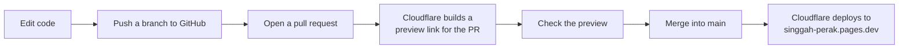

# How SinggahPerak works

This explains the project from the idea down to the code, so you can present it confidently and answer the panel's questions.

---

## 1. The idea in 30 seconds

**Problem:** Foreign tourists to Perak fell about 1.5% in 2025, and many only *stop* in Perak and then sleep in Penang or KL. Flights to Ipoh are limited.

**Solution:** A website that plans trips to Perak **by train** (ETS) for visitors from Thailand, Singapore and Indonesia. Every plan:
- includes **at least one night in Perak**
- sends most of the money to **kampung sellers** (homestays, guides, stalls, craft makers)
- feeds data back to the **state** so it can see where the money goes

**Tagline:** *Jangan sekadar singgah. Bermalamlah di Perak.*

---

## 2. Three users, three pages

| Who | Page | What they do |
|---|---|---|
| 🧳 **Tourist** (Thai, Singaporean, Indonesian) | `index.html`: trip planner | Picks country, days and interests, gets a trip plan, books it |
| 🏡 **Kampung seller** (homestay, guide, stall) | `seller.html`: seller sign-up | Registers their business so tourists can find and book them |
| 🏛️ **State government** (e.g. Tourism Perak) | `dashboard.html`: dashboard | Sees bookings, nights in Perak, spending by district and the impact estimate |

How they connect:



---

## 3. The tourist flow (trip planner)

```mermaid
flowchart TD
    A[Open the site] --> B[Choose language<br/>BM / EN / TH / ID / ZH]
    B --> C[Pick: country, 2–4 days,<br/>interests, Muslim-friendly?]
    C --> D[Press 'Build my trip']
    D --> E[Plan appears: day by day,<br/>with train, stops, sellers, prices]
    E --> F{New sellers on the route?}
    F -->|yes| G[Add them to the trip<br/>→ total and kampung % go up]
    F -->|no| H
    G --> H[Press 'Book this trip (demo)']
    H --> I[Demo QR + confirm]
    I --> J[Booking saved → shows on the dashboard]
```

### What the plan shows
- **4 headline numbers:** nights in Perak, estimated spend per person, % going to kampung sellers, districts visited
- **Singgah vs Bermalam card:** what a visitor spends on a quick stopover (RM55: a walk plus a meal) compared with this trip (e.g. RM505), shown as "9.2× more spent in Perak"
- **Day-by-day timeline:** train in, stops with times, prices and seller tags, overnight stay, train home
- **How you pay:** the visitor's own banking app (PromptPay, QRIS or a Singapore bank) scans the seller's DuitNow QR

### How a plan is built (the logic)
Every trip follows the same shape:

| Day | What goes in |
|---|---|
| **Day 1** | 🚆 Arrive by train → Ipoh Old Town → dinner → Kinta Riverwalk night stalls → 🌙 Ipoh homestay |
| **Middle days** (only for 3 or 4 days) | One **full-day block** per day, chosen by interest (see below), ending with 🌙 a night in that area |
| **Last day** | Kellie's Castle → souvenirs (pomelo, crafts) → 🚆 train home |

The four full-day blocks:

| Interest | Full day | Overnight |
|---|---|---|
| 🏛️ Heritage | Kuala Kangsar (Ubudiah Mosque, Royal Museum) → Labu Sayong pottery → Lenggong Valley (UNESCO) | Kampung Sayong homestay |
| 🌿 Nature | Gua Tempurung → Gopeng river & waterfall → Tambun hot springs | Gopeng eco-homestay |
| 🍜 Food | Ipoh breakfast trail → Tambun pomelo farm → cafés & murals → night market food tour | Ipoh homestay |
| 🏝️ Island | Lumut → Pangkor ferry → fishing village by local boat → seafood & satay ikan | Pangkor village chalet |

Blocks are picked in the order the visitor ticked their interests. If there are more days than interests, the remaining interests fill in.

**Muslim-friendly mode** swaps the bean sprout chicken dinner for nasi ganja.

**Example:** Thailand, 3 days 2 nights, Heritage → Day 1 Ipoh, Day 2 Kuala Kangsar and Lenggong, Day 3 Kellie's Castle then home = **2 nights in Perak, RM505, 89% to kampung sellers, 3 districts**.

---

## 4. The seller flow

1. The seller opens **seller.html** and fills in: business name, type (homestay / guide / food / craft / activity), district, price, short description, DuitNow ID.
2. They press **Register (demo)**.
3. When any tourist builds a trip that **passes through that district**, the seller appears under *"New community sellers on your route"*.
4. The tourist can **add** them. The trip total and kampung share go up, and the seller is included in the booking.

**Why it matters for judging:** this turns the project from a tourist app into **social innovation**. Kampung sellers join with no new payment system, because the DuitNow QR they already have works for foreign visitors.

---

## 5. The state flow (dashboard)

The dashboard has four parts:

1. **Context (official figures):** 3 real numbers with sources: 10.4M domestic overnight arrivals (2025), −1.5% international (2025), 1.1M target (2026).
2. **Prototype data:** 60 generated sample bookings **plus** any bookings made on this device:
   - tiles: trips booked, average nights in Perak, total spend, % to kampung sellers
   - charts: trips by country, trips by nights, spend by district
   - map: circles sized by spending in each district
   - latest bookings table (live ones have a green dot)
3. **Impact calculator:** "What if X% of international tourists stayed one extra night?"
   - extra nights = tourists × %
   - extra spending = extra nights × spend per night
   - to kampung = extra spending × kampung %
   - Defaults: 1.1M tourists (state target), 5%, spend per night and kampung % from the prototype's averages → **55,000 nights, about RM14.8M, about RM12.3M to kampung sellers**
4. **Live update:** if the planner is open in another tab, a new booking appears on the dashboard immediately.

---

## 6. What's real and what's a prototype

| Real ✅ | Prototype / sample ⚠️ |
|---|---|
| Problem numbers (with sources) | Seller names (marked *Contoh*) |
| Attractions (Ubudiah, Lenggong, Gua Tempurung…) | Prices (rough estimates) |
| ETS routes (Padang Besar, JB Sentral, KL Sentral → Ipoh) | Train times: official KTMB data once `update_trains.py` is run; until then from train36.com |
| Cross-border DuitNow QR exists (PromptPay, QRIS) | QR code: a placeholder, no payment |
| | Dashboard bookings: generated samples |
| | Impact calculator: an estimate, not a forecast |

If a judge asks, say it plainly: *"The rail routes, attractions and QR payment links are real. The sellers, prices and bookings are sample data for the prototype. The next step is a pilot with real sellers in Kinta and Kuala Kangsar."*

---

## 7. How the code works

### No server, no database
It's a **static website**: HTML, CSS and JavaScript only. Everything runs in the visitor's browser. Data is saved in the browser's **localStorage**, so each person's demo data stays on their own device.

| localStorage key | Holds |
|---|---|
| `singgahperak_lang` | Chosen language (default: BM) |
| `singgahperak_sellers` | Sellers registered on seller.html |
| `singgahperak_bookings` | Bookings made in the planner |

### Files

```
public/
  index.html        → loads trains.js, core.js, i18n.js, planner.js
  seller.html       → loads core.js, i18n.js, seller.js
  dashboard.html    → loads chart.umd.js, leaflet.js, core.js, i18n.js, dashboard.js
  assets/
    js/core.js        Shared data + logic (used by all 3 pages)
    js/i18n.js        All text in 5 languages
    js/planner.js     Trip planner page
    js/seller.js      Seller sign-up page
    js/dashboard.js   Dashboard page
    css/style.css     Look and feel (light + dark mode, mobile)
    vendor/           Chart.js (charts) and Leaflet (map), stored locally
```

### `core.js`: the brain

| Piece | What it is |
|---|---|
| `ORIGINS` | The 3 countries: train route, fallback train number and times, payment note |
| `KTMB_TRAINS` (from `trains.js`) | Official KTMB trains in and out for each country. Replaces the fallback when present. |
| `STOPS` | Every place in a plan: name, district, price, seller, description in 5 languages |
| `SELLERS` | The 11 sample kampung sellers |
| `DAY_BLOCKS` | The 4 full-day blocks (heritage, nature, food, beach) |
| `buildPlan(origin, days, interests, halal)` | Builds the day-by-day plan (section 3) |
| `planTotals(plan)` | Adds up total spend, kampung spend and spend by district |
| `stopoverSpend()` | The RM55 stopover figure for the Singgah vs Bermalam card |
| `loadRegisteredSellers()` / `saveRegisteredSellers()` | Read or save sellers from seller.html |
| `saveBooking(plan)` / `loadBookings()` | Save or read bookings |
| `sampleBookings(60)` | Makes the 60 sample bookings for the dashboard. The same numbers come out every time. |

### `i18n.js`: languages
- Each piece of text has a key, e.g. `btn_generate` → "Bina perjalanan saya" (BM) / "สร้างแผนเที่ยว" (TH).
- HTML elements with `data-i18n="key"` are filled in automatically.
- The planner is in all 5 languages. The seller page and dashboard are in BM and English, since those users are Malaysian.
- Missing text falls back to English.

### What happens when you press "Build my trip"
1. `planner.js` reads the form (country, days, interests, halal).
2. It calls `buildPlan()` in `core.js`, which returns the plan with its totals.
3. `renderPlan()` draws the numbers, the Singgah vs Bermalam card, the timeline, the sellers on the route and the Book button.
4. **Book → Confirm** calls `saveBooking()`, which writes to localStorage.
5. `dashboard.js` reads it with `loadBookings()`, adds it to the samples and redraws everything. An open dashboard tab updates instantly through the browser's `storage` event.

---

## 8. How to change things

| I want to… | Edit |
|---|---|
| Refresh train times | Run `python3 scripts/update_trains.py` (official KTMB data → `trains.js`). The fallback times are in `ORIGINS` in `core.js`. |
| Change a price or description | `STOPS` in `core.js` |
| Add a new place | Add it to `STOPS`, then put its key into a `DAY_BLOCKS` list |
| Change any text on screen | `public/assets/js/i18n.js` (change it in every language) |
| Change colours or layout | `public/assets/css/style.css` |
| Change the problem numbers | `public/index.html` and `public/dashboard.html` |

Test locally before pushing:

```bash
python3 -m http.server 8000 --directory public
# open http://localhost:8000
```

---

## 9. From code to live website



- Cloudflare serves only the `public/` folder, so `docs/` and the README are never on the website.
- There's no build step. Cloudflare serves the files as they are.

---

## 10. Demo script (60 seconds)

1. **seller.html** → register "Homestay Mak Teh", Kuala Kangsar, RM90.
2. **Planner** → switch the language to ไทย → 🇹🇭 Thailand, 3 days 2 nights, Heritage → *Build my trip*.
3. Point at: **2 nights in Perak**, the **Singgah vs Bermalam** card, the train number, the seller tags.
4. Add **Homestay Mak Teh** → the kampung share goes up.
5. **Book** → demo QR → confirm.
6. Switch to the **dashboard** tab → the booking appears with a green dot.
7. End on the **impact calculator**: *"If 5% of the 1.1 million target stay one more night, that's about RM14.8M for Perak, and about RM12.3M of it goes to kampung sellers."*
